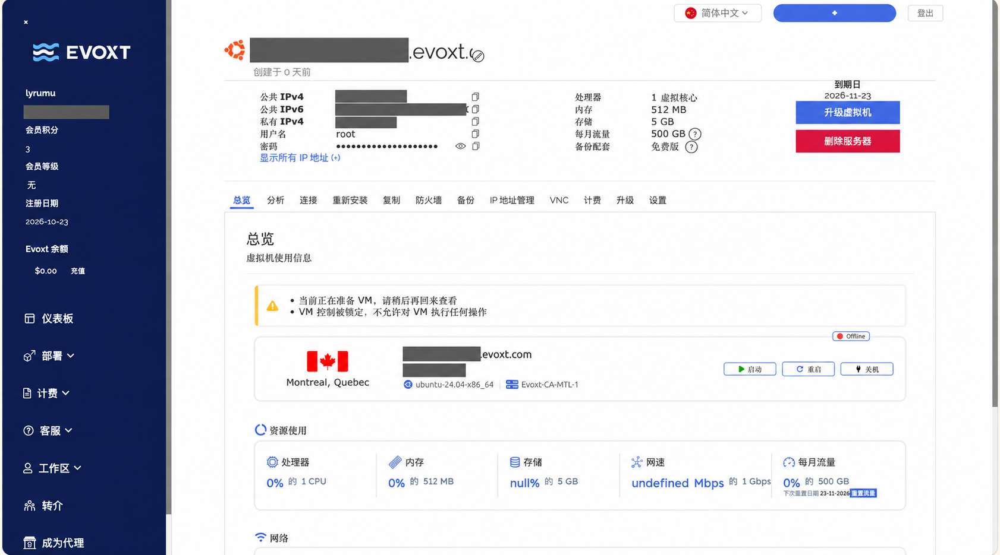
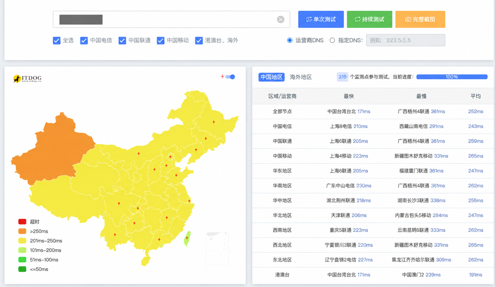
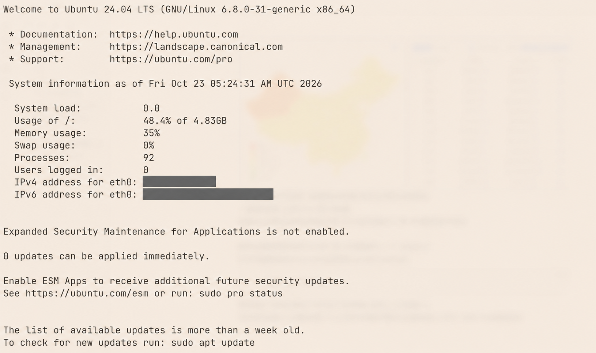
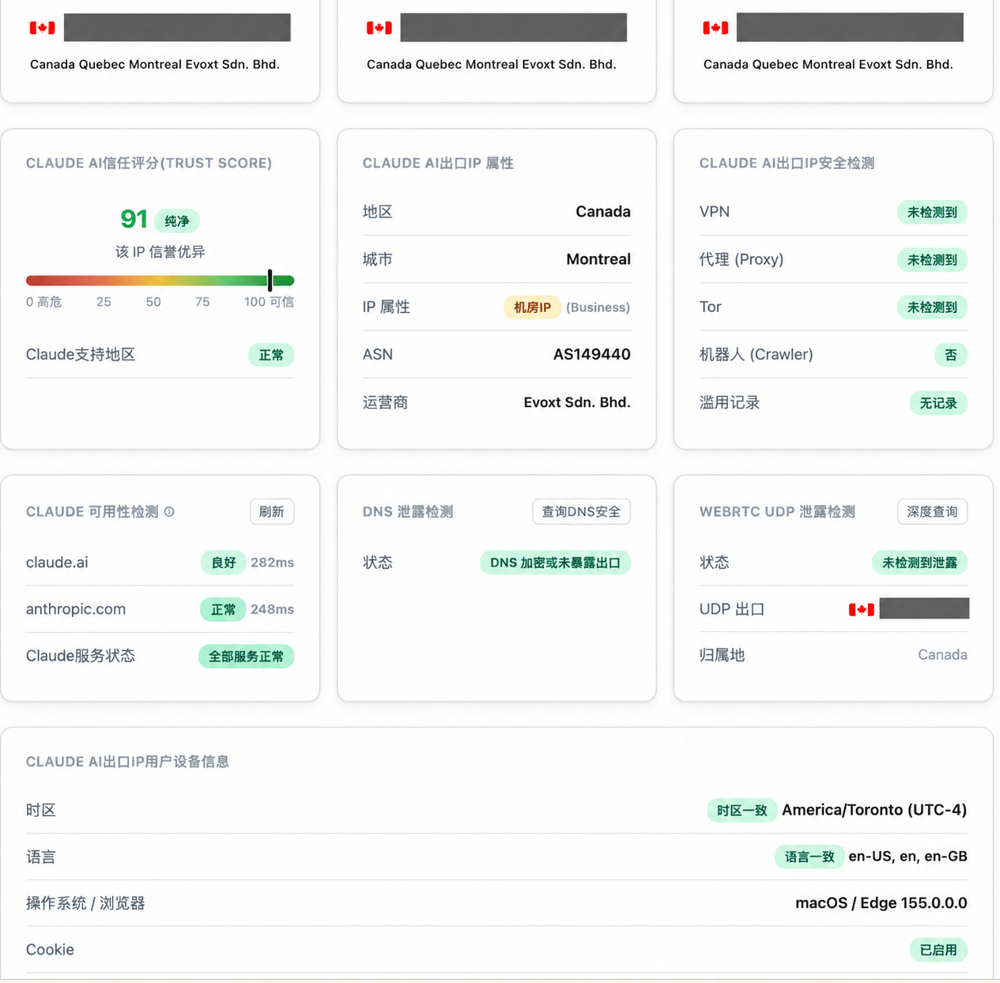

## 使用前先检查环境

最终目标就是将 [Claude AI 风险监测](https://ip.net.coffee/claude/) 中的指标尽可能地都变成**绿色**，其中最重要的就是 IP 地址。

> 注意，一定是先等到设备检测指标都为绿色了，再开始进入 Claude 的网址进行注册和订阅。
>
> 每次设备重启，都先检查一下指标是否正常，顺序不要搞错。

***

## 选择并检测 VPS

尽量确保 IP 地址**干净纯粹并且独享**，因为 Claude 有连坐机制，同 IP 一个人被封禁，其余所有人都会受牵连。

所以需要租用[海外服务器](https://digvps.com/)：点击“测评”，选择合适的 VPS。重点对比 **IP 纯净度**和**网络速度（延迟）**，地区尽可能选择美国。

云服务器大致要求：

| 项目 | 要求 |
| --- | --- |
| CPU | 1 核够用 |
| 内存 | 512 MB 及以上 |
| 硬盘 | 推荐 10 GB 左右 |
| 流量 | 500 GB 左右就够用，要看租期时长 |



购买 VPS 后：

1. 点进去将服务器“启动”起来。
2. 使用 [VPS 的 IP 稳定性检测](https://www.itdog.cn/ping/)，点击“在线 Ping”，检测一下该服务器的 IP 质量，一般使用公有 IPv4 进行检测。



如果无法直连或者速度过慢，可以尝试提交工单，申请更换 IP 地址。

***

## 将 VPS 搭建为中转节点

### 连接云服务器

购买好能够使用的 VPS 后，将 VPS 搭建为一个中转节点。

打开电脑终端（PowerShell 或者 Mac 的 Terminal），将下面的“用户名”和“IPv4地址”替换为服务器的信息：

```bash
# 通过 SSH 连接云服务器。
ssh 用户名@IPv4地址
```

然后输入密码。密码不会显示在终端，实际上已经输入。

这样就连接上云服务器了。之后所有操作都在云服务器上进行，本机不会被修改，可以理解为远程操控另一台电脑。



### 安装流量中转服务

然后使用脚本一键在云服务器安装流量中转服务：

```bash
# 在已连接的云服务器上安装 sing-box 流量中转服务。
bash <(curl -fsSL --connect-timeout 15 --retry 3 https://github.com/233boy/sing-box/raw/main/install.sh)
```

执行成功之后，复制和保存显示出来的链接（URL）。这个链接就可以理解为是一个 VPN 订阅。

更多信息阅读[脚本作者的文档](https://233boy.com/sing-box/sing-box-script/)。

***

## 配置 Clash Verge Rev

1. 使用 [Vless to Clash 转换器](https://shipengtao.com/en/tools/vless-to-clash/)，把刚刚脚本执行后获得的链接 URL 转换为 `clash.yaml` 文件。
2. 将转换好后的文件下载保存到本机电脑。
3. 安装本机的客户端 [Clash Verge Rev](https://github.com/Clash-Verge-rev/clash-verge-rev/releases)。
4. 进入“订阅”，新建订阅，配置选择“本地”，名称随意，然后选择刚刚的 `clash.yaml` 文件导入。
5. 最后“使用”该订阅配置。

> 记得一定要在首页安装并打开“虚拟网卡模式”，确保所有流量都走代理。

然后再来到 [Claude AI 风险监测](https://ip.net.coffee/claude/)网址，刷新一下，就会发现 IP 都显示正确了。



***

## 调整 IPv6、浏览器语言和时区

### IPv6

如果 IPv6 显示还是不对，可能需要关闭本机 IPv6（对大多数应用的使用无影响，且可以恢复）。

可以告诉 AI 自己的设备，然后询问关闭 IPv6 的具体方法。

### 浏览器语言

最后需要把浏览器语言改为英语，删除中文语言选项，可以多备几个浏览器使用。

### 系统时区

然后把系统时区设置为和 VPS 地区接近的时区，也是通过询问 AI 来修改，macOS 和 Windows 方法不同。

***

## 注册、订阅与后续使用

当 Claude AI IP 检测网页中的指标全部变绿，显示机房 IP 的警告可以忽略。似乎并不是一定要家宽，但家宽确实更好；机房 IP 的话，最好从此就不要变化了。

然后就可以尝试访问 [Claude 官网](https://claude.ai/)页面进行注册和使用了。

充值订阅之前，先养号一段时间（网页版聊天），然后再充值 Pro，循序渐进，最后有需要再充值 Max。充值过后最好仍保持适当的网页版聊天。

使用 Claude Code 时，建议使用虚拟机，一机一号，保证环境干净纯粹。
