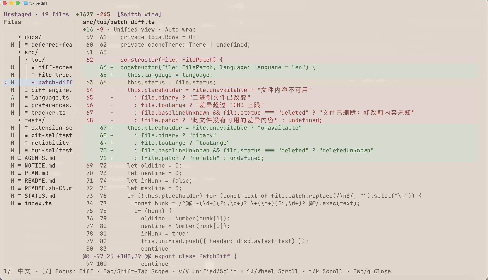
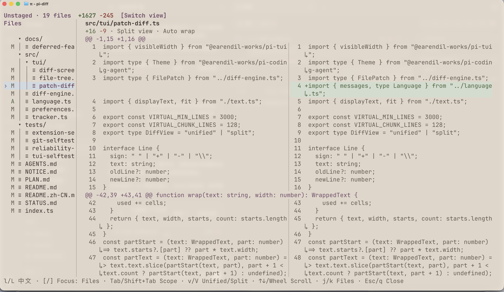
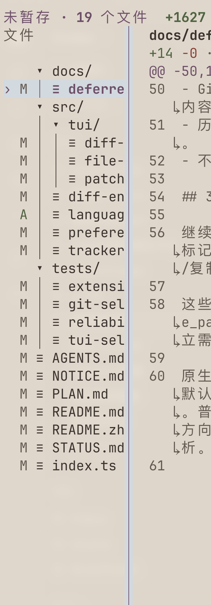

[](https://github.com/lyrumu/pi-diff/blob/5c9a75829f27d5738b945d028e99832b852b81a9/README.md) [](https://github.com/lyrumu/pi-diff/blob/5c9a75829f27d5738b945d028e99832b852b81a9/README.zh-CN.md)

Review per-turn, session-wide, and Git changes in a fullscreen TUI inside [pi](https://github.com/earendil-works/pi). Browse changed files on the left and inspect diffs on the right, with mouse support, automatic line wrapping, and unified or split views.

***

## Features

- **Review at different scopes:** inspect the latest task, session total, or Git changes, with file counts and added/removed line totals.
- **Keep your history:** recorded task diffs remain available after reloading pi, resuming a session, or switching session branches.
- **Use either language:** switch between English and Simplified Chinese with `l` / `L`; your choice is remembered.
- **Review safely:** viewing diffs does not stage, commit, or revert files. Task and session views also work outside Git repositories.

### Unified and split views

Read changes in one column or compare old and new content side by side. Press `v` / `V` or click the view toggle to switch. Long lines wrap automatically, and colors follow your pi theme. Added/deleted files and narrow windows use unified view.





Click either image to view it at full size.

### File tree and draggable divider



Find changed files in collapsible directories. `A`, `M`, and `D` indicate added, modified, and deleted files.

Drag the divider to give more space to the tree or diff; double-click to reset. Drag to the left edge to hide the tree, then press `[` or click `[Show files]` to bring it back.

### Inspired by opencode

Inspired by [opencode](https://github.com/anomalyco/opencode), pi-diff brings its terminal diff review experience into pi through `/diff`.

***

## Installation

Project development environment: pi **1.2.0 or later**, Node.js ≥ 22.19.0, npm, and Git.

```bash
# Install the extension
pi install npm:@lyrumu/pi-diff
```

Alternatively, install from GitHub:

```bash
# Install from GitHub
pi install git:github.com/lyrumu/pi-diff
```

Restart pi after installation, or enter `/reload` in a running session.

To update or uninstall:

```bash
# Update the extension
pi update npm:@lyrumu/pi-diff

# Uninstall the extension
pi remove npm:@lyrumu/pi-diff
```

If you installed from GitHub, use `git:github.com/lyrumu/pi-diff` as the source in both commands instead.

***

## Usage

Start pi in your project directory and enter `/diff`. Git repositories open **Unstaged** by default; other projects open **Last turn**. To browse files, press `[`, select with `j` / `k`, then press `]` to read and scroll the diff. The interface starts in English; press `l` / `L` for Simplified Chinese.

Press `Tab` / `Shift+Tab` to cycle forward or backward through the available scopes:

| Scope | Changes shown |
|---|---|
| Last turn | Changes from the most recent task |
| Session total | Cumulative changes recorded on the current session branch |
| Unstaged | Changes that have not been staged |
| Uncommitted | Staged and unstaged changes |
| All branch changes | Changes relative to the base branch, including committed and uncommitted work |

Git scopes also include untracked files. Outside a Git repository, only the first two scopes are available.

### Keyboard and mouse


The shortcut bar follows the current focus: `j` / `k` select files when the tree is focused and scroll when the diff is focused.

| Action | Keyboard / mouse |
|---|---|
| Select files and collapse directories | Click; use `↑↓` in the file tree and `Enter` / Space to expand or collapse directories |
| Next / previous file | `j` / `k` while the file tree is focused |
| Focus the file tree / diff | `[` / `]`, or click the corresponding pane |
| Resize / hide the file tree | Drag the divider; drag to the left edge to hide; double-click to reset the width |
| Show the hidden file tree | `[` or click `[Show files]` at the top |
| Scroll the diff | Mouse wheel, `↑↓`, `j` / `k`, `PageUp` / `PageDown`; `Home` / `End` jump to the start / end |
| Switch unified / split view | `v` / `V`, or click the view toggle at the top |
| Switch English / Simplified Chinese | `l` / `L` |
| Close | `Esc` / `q` |

In narrow windows, `[` / `]` switch between the file tree and diff pages.

***

## Data and limitations

- Task and session history only covers changes recorded after enabling the extension, within the project directory. Git scopes can show existing changes.
- Outside Git repositories, shell changes may show `Previous contents unknown`. If a complete session total cannot be restored, the viewer says so.
- Binary files and diffs exceeding 10 MB show a notice instead of their contents.

***

## License

[MIT](https://github.com/lyrumu/pi-diff/blob/5c9a75829f27d5738b945d028e99832b852b81a9/LICENSE). Parts of the implementation are ported from [opencode](https://github.com/anomalyco/opencode). See [NOTICE.md](https://github.com/lyrumu/pi-diff/blob/5c9a75829f27d5738b945d028e99832b852b81a9/NOTICE.md) and [third-party licenses](https://github.com/lyrumu/pi-diff/blob/5c9a75829f27d5738b945d028e99832b852b81a9/THIRD_PARTY_LICENSES.md) for attribution and license terms.
