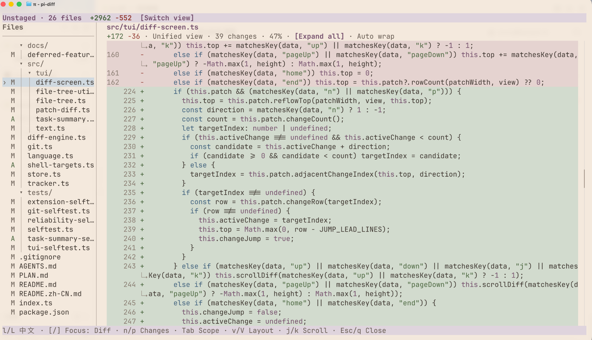
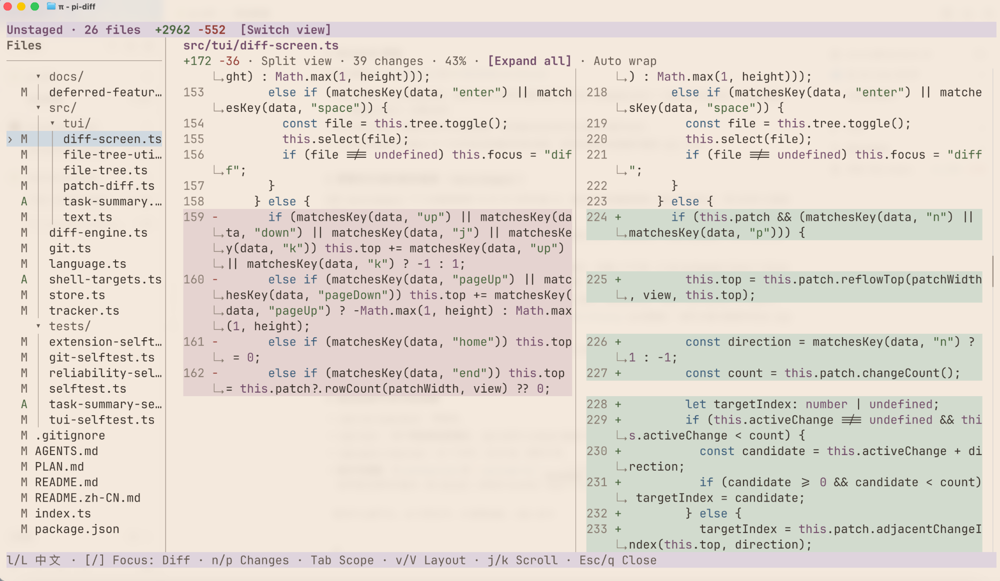
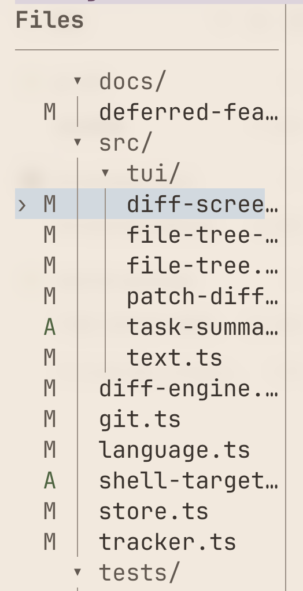
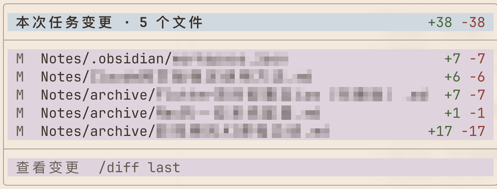

[](https://github.com/lyrumu/pi-diff/blob/f8431cf0e3037af5cd41ac0dce5bf44c46cdffa5/README.md) [](https://github.com/lyrumu/pi-diff/blob/f8431cf0e3037af5cd41ac0dce5bf44c46cdffa5/README.zh-CN.md)

Review per-turn, session-wide, and Git changes in a fullscreen TUI inside [pi](https://github.com/earendil-works/pi). Browse changed files on the left and inspect diffs on the right, with mouse support, automatic line wrapping, and unified or split views.

***

## Features

- **Review at different scopes:** inspect the latest task, session total, or Git changes, with file counts and added/removed line totals.
- **See what each task changed:** the task summary shows changed files and line counts. Use `/diff last` to inspect the latest task directly.
- **Find the next edit:** jump between changes with `n` / `p`, expand folded context as needed, and switch files without losing your place in the current scope.
- **Keep your history:** recorded task diffs remain available after reloading pi, resuming a session, or switching session branches.
- **Use either language:** switch between English and Simplified Chinese with `l` / `L`; your choice is remembered.
- **Review safely:** viewing diffs does not stage, commit, or revert files. Task and session views also work outside Git repositories.

### Unified and split views

Read changes in one column or compare old and new content side by side. Press `v` / `V` or click the view toggle to switch. Supported code files use pi's syntax highlighting, focused in-place edits show word-level emphasis, long lines wrap automatically, and colors follow your pi theme. Added/deleted files and narrow windows use unified view.





Click either image to view it at full size.

### File tree and draggable divider

<div style="max-width: 220px; margin-inline: auto;">



</div>

Find changed files in collapsible directories. `A`, `M`, and `D` indicate added, modified, and deleted files.

Drag the divider to give more space to the tree or diff; double-click to reset. Drag to the left edge to hide the tree, then press `[` or click `[Show files]` to bring it back.

### Task change summary

On Pi hosts with entry rendering, a summary appears when the task ends, including interrupted tasks and tasks with no recorded changes. The card shows up to 12 files and a count of any remaining files. Use `/diff last` to see the full list and inspect each diff.



### Inspired by opencode

Inspired by [opencode](https://github.com/anomalyco/opencode), pi-diff brings its terminal diff review experience into pi through `/diff`.

***

## Installation

Project development environment: pi **1.2.0 or later**, Node.js ≥ 22.19.0, npm, and Git.

```bash
# Install the extension
pi install npm:@lyrumu/pi-diff
```

Alternatively, install from GitHub:

```bash
# Install from GitHub
pi install git:github.com/lyrumu/pi-diff
```

Restart pi after installation, or enter `/reload` in a running session.

To update or uninstall:

```bash
# Update the extension
pi update npm:@lyrumu/pi-diff

# Uninstall the extension
pi remove npm:@lyrumu/pi-diff
```

If you installed from GitHub, use `git:github.com/lyrumu/pi-diff` as the source in both commands instead.

***

## Usage

Start pi in your project directory and enter `/diff`. Git repositories open **Unstaged** by default; other projects open **Last turn**. To browse files, press `[`, select with `j` / `k`, then press `]` to read and scroll the diff. The interface starts in English; press `l` / `L` for Simplified Chinese.

Press `Tab` / `Shift+Tab` to cycle forward or backward through the available scopes:

| Scope | Changes shown |
|---|---|
| Last turn | Changes from the most recent task |
| Session total | Cumulative changes recorded on the current session branch |
| Unstaged | Changes that have not been staged |
| Uncommitted | Staged and unstaged changes |
| All branch changes | Changes relative to the base branch, including committed and uncommitted work |

Git scopes also include untracked files. Outside a Git repository, only the first two scopes are available.

### Keyboard and mouse


The shortcut bar follows the current focus: `j` / `k` select files when the tree is focused and scroll when the diff is focused.

| Action | Keyboard / mouse |
|---|---|
| Select files and collapse directories | Click; use `↑↓` in the file tree and `Enter` / Space to expand or collapse directories |
| Next / previous file | `j` / `k` while the file tree is focused |
| Focus the file tree / diff | `[` / `]`, or click the corresponding pane |
| Resize / hide the file tree | Drag the divider; drag to the left edge to hide; double-click to reset the width |
| Show the hidden file tree | `[` or click `[Show files]` at the top |
| Scroll the diff | Mouse wheel, `↑↓`, `j` / `k`, `PageUp` / `PageDown`; `Home` / `End` jump to the start / end |
| Jump to the next / previous change in this file | `n` / `p` while the diff is focused |
| Expand / fold unchanged context in this file | Click a folded block to expand it, or click `[Expand all]` / `[Fold context]` in the file bar |
| Switch unified / split view | `v` / `V`, or click the view toggle at the top |
| Switch English / Simplified Chinese | `l` / `L` |
| Close | `Esc` / `q` |

In narrow windows, `[` / `]` switch between the file tree and diff pages.

The viewer folds runs of more than 12 unchanged lines by default, keeping three context lines next to each change. Click any folded row to expand that section, or click `[Expand all]` / `[Fold context]` in the file bar to toggle all folded sections in the current file. The file bar shows change and scroll progress when applicable. Wider views also show a scrollbar. Switching between files within the same scope remembers each file's scroll position and expanded context.

***

## Data and limitations

- Task cards use persisted diffs, stay out of model context, and share the viewer's language preference. Hosts without an entry renderer retain the viewer and show an upgrade notice.
- Task and session history covers changes recorded after enabling the extension. Explicit `edit`/`write` targets and identified literal shell file targets can be outside the workspace; external paths remain absolute and appear under **External files**. Git scopes remain repository-local.
- Task history includes only explicit Pi write targets: edit/write and identified shell redirections, copies/moves/removals, touch/chmod/tee, simple `sed -i` and `ln` forms. Capture occurs immediately before the first write and is frozen at tool completion; verified net-zero changes disappear. Reads alone never count as writes.
- Task capture no longer scans the workspace or attributes unrelated filesystem changes to Pi. Concurrent Codex/editor changes to other files stay outside task and session scopes. This works without Git and for explicit external paths; the three Git scopes still describe repository-wide state.
- Shell code is never evaluated to infer paths. Scripts, custom tools and recursive directory operations with unidentified targets are not automatically included. Relative targets are skipped when a directory change such as `popd` leaves the working directory uncertain. Detected interference between Pi writes prevents a precise merged patch. Broken content continuity between tasks falls back to the latest own turn in session totals. Concurrent writes to the same target during a single tool execution cannot be reliably separated.
- Cards omit generic tracking paragraphs and use `?` / `—` for unavailable results; details remain in the viewer. Previously persisted history is not rewritten.
- Binary files and diffs exceeding 10 MB show a notice instead of their contents. Task capture checks both file versions for non-UTF-8 bytes. Git scopes check the bytes emitted in the patch, including its configured context. Images have no visual preview. SVG files show source changes.
- Symlink targets and executable-bit changes are tracked; file mode changes appear in the diff.

***

## License

[MIT](https://github.com/lyrumu/pi-diff/blob/f8431cf0e3037af5cd41ac0dce5bf44c46cdffa5/LICENSE). Parts of the implementation are ported from [opencode](https://github.com/anomalyco/opencode). See [NOTICE.md](https://github.com/lyrumu/pi-diff/blob/f8431cf0e3037af5cd41ac0dce5bf44c46cdffa5/NOTICE.md) and [third-party licenses](https://github.com/lyrumu/pi-diff/blob/f8431cf0e3037af5cd41ac0dce5bf44c46cdffa5/THIRD_PARTY_LICENSES.md) for attribution and license terms.
